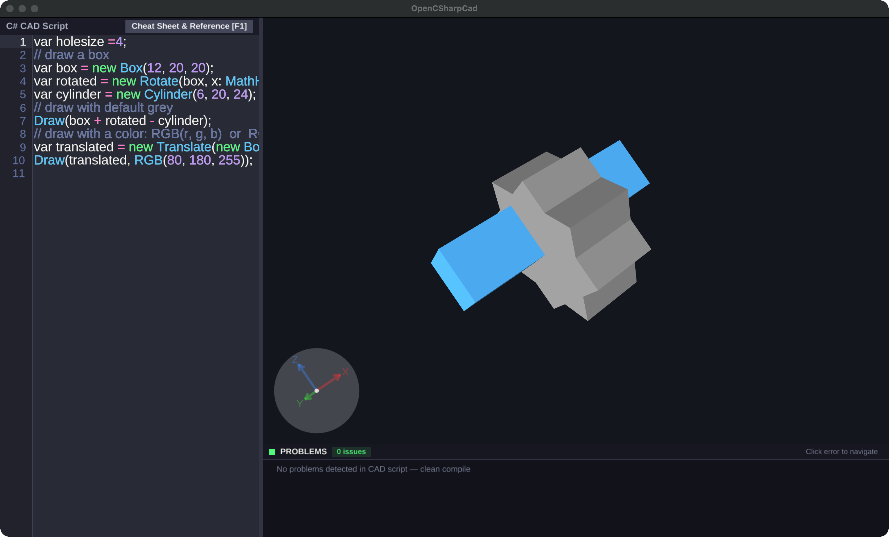
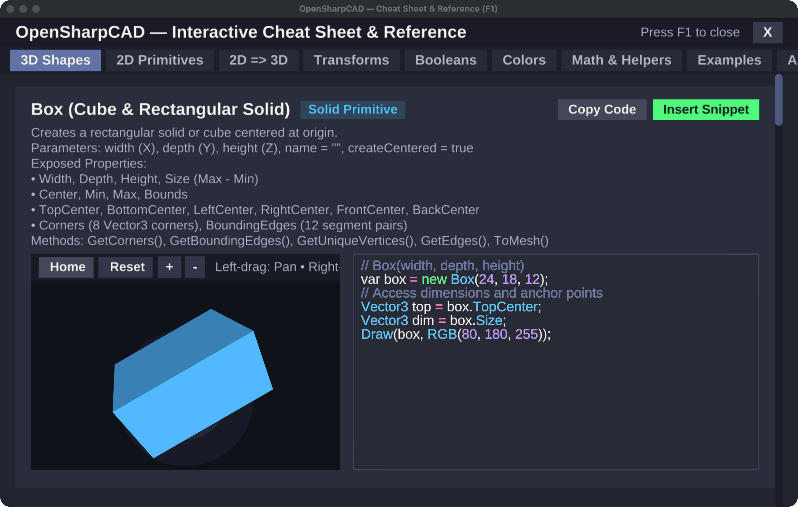

<div align="center">

# 💎 OpenSharpCAD

### **Parametric 3D CAD Using C# and .NET**

[](https://github.com/roboter/OpenSharpCAD/actions/workflows/publish.yml)
[](https://dotnet.microsoft.com/download/dotnet/10.0)
[](https://learn.microsoft.com/en-us/dotnet/csharp/)
[](https://github.com/roboter/OpenSharpCAD)
[](doc/index.html)
[](Submodules/agg-sharp/LICENSE)
[](https://github.com/roboter/OpenSharpCAD/pulls)

<p align="center">
  <b>Design 3D printable parts, mechanical assemblies, and parametric models with the power, speed, and elegance of C#.</b><br>
  <i>Inspired by OpenSCAD • Powered by Microsoft Roslyn • Hardware-accelerated OpenGL / WebGL</i>
</p>

<p align="center">
  <a href="#-screenshots">📸 Screenshots</a> •
  <a href="#-video-demo">📺 Video</a> •
  <a href="#-key-features">⚡ Features</a> •
  <a href="#-code-examples">💡 Examples</a> •
  <a href="#-interactive-documentation">🌐 Documentation</a> •
  <a href="#-getting-started">🚀 Quick Start</a> •
  <a href="#️-build-instructions">🛠️ Build</a> •
  <a href="#-security-considerations">🔒 Security</a>
</p>

</div>

---

## 📸 Screenshots

### 💻 Main IDE & Live 3D Viewport

<div align="center">
  
  <p><i>The OpenSharpCAD IDE: Live C# scripting with Roslyn compilation on the left, real-time OpenGL 3D viewport with interactive trackball camera and axis gizmo on the right.</i></p>
</div>

<br>

### 📚 Interactive In-App Cheat Sheet & Reference (`F1`)

<div align="center">
  
  <p><i>The in-app Cheat Sheet & Reference window (press <code>F1</code>): Category tabs, method signatures, live 3D preview viewports, and one-click code insertion.</i></p>
</div>

---

## 📺 Video Demo

<div align="center">
  <a href="https://youtu.be/dlQ3HhHRtSU" target="_blank" rel="noopener">
    
  </a>
  <p>▶️ <b><a href="https://youtu.be/dlQ3HhHRtSU">Click here to watch the OpenSharpCAD live demonstration on YouTube</a></b></p>
</div>

---

## ⚡ Key Features

- 📐 **Intuitive CSG Boolean Math**: Compose 3D solids naturally using overloaded operators (`+` Union, `-` Difference, `*` Intersection).
- 🧊 **Rich 3D Solid Primitives**: Built-in parameterized `Box`, `Cylinder`, `Sphere`, `Torus`, and `Cone`.
- ✏️ **2D Primitives & 3D Extrusions**: `Circle`, `Rectangle`, `Square`, `Line`, `Point`, `Path`, `LinearExtrude`, and `RotateExtrude` (lathe/revolve).
- 🔄 **Parametric Transformations**: `Translate`, `Rotate`, `Scale`, and `Mirror` (available as constructor wrappers or fluent extension methods).
- 🎯 **Topology & Anchor Queries**: Access `.TopCenter`, `.BottomCenter`, `.Corners`, `.BoundingEdges`, and `.GetUniqueVertices()` to attach secondary parts parametrically without manual coordinate calculation.
- 🎨 **RGB & RGBA Color Styling**: Render custom colors with `Draw(shape, RGB(r, g, b))` or `RGBA(...)`.
- ⚡ **Instant Live Recompilation**: Automatic compilation and 3D preview updates powered by Microsoft Roslyn upon code modifications.
- 📁 **File Management**: Create new files, open existing scripts, save, and save as with native system dialogs and keyboard shortcuts (`Ctrl/Cmd+N`, `Ctrl/Cmd+O`, `Ctrl/Cmd+S`, `Ctrl/Cmd+Shift+S`).
- 🎬 **Parametric Animation System**: OpenSCAD-compatible `$t` (or `t` / `Time`) animation variable with Play/Pause controls, automatic Time tracking, customizable FPS, and Steps settings.
- 📚 **Interactive 3D Documentation**:
  - In-app reference cheat sheet (press `F1` or click Help).
  - Standalone Three.js WebGL documentation viewer with side-by-side 3D models and Dracula-themed C# snippets.
- 💻 **Cross-Platform**: Native support for macOS (Intel & Apple Silicon), Windows, and Linux via .NET 10.0 and GLFW.

---

## 💡 Code Examples

### 1️⃣ Basic CSG Operations & Colors (Featured in Screenshot)

Create shapes, apply rotations, perform boolean union and subtraction, and draw with custom RGB colors:

```csharp
var holesize = 4;

// 1. Create a box and a 45-degree rotated box
var box = new Box(12, 20, 20);
var rotated = new Rotate(box, x: MathHelper.DegreesToRadians(45));

// 2. Create a cylinder for cutting a hole
var cylinder = new Cylinder(6, 20, 60);

// 3. Draw CSG composite with default grey: (box + rotated) - cylinder
Draw(box + rotated - cylinder);

// 4. Create and translate a mounting bar, drawn with custom RGB color
var translated = new Translate(new Box(40, 10, 10), 0, holesize, holesize);
Draw(translated, RGB(80, 180, 255));
```

---

### 2️⃣ CSG Boolean Math (Union, Difference, Intersection)

OpenSharpCAD uses intuitive operator overloading for Constructive Solid Geometry:

```csharp
var outer = new Box(30, 30, 30);
var cutter = new Cylinder(radius: 10, height: 40);
var innerSphere = new Sphere(radius: 18);

// Difference (-): Drill a hole through the box
var hollowBox = outer - cutter;

// Union (+): Combine two solids into one
var combined = hollowBox + new Cylinder(5, 50).Translate(0, 0, 10);

// Intersection (*): Keep only overlapping volume
var lens = outer * innerSphere;

Draw(combined, RGB(255, 140, 0));
```

---

### 3️⃣ 2D Shapes & 3D Extrusions

Design 2D cross-sections and extrude or revolve them into 3D solids:

```csharp
// Linear extrusion of a 2D rectangle
var rect2D = new Rectangle(width: 25, height: 15);
var extrudedSolid = new LinearExtrude(rect2D, height: 20);
Draw(extrudedSolid, RGB(50, 205, 50));

// Rotational extrusion (lathe / revolve) around Z axis
var crossSection = new Circle(radius: 6);
var revolvedTorus = new RotateExtrude(crossSection, sweepDegrees: 360);
Draw(revolvedTorus, RGB(186, 85, 211));
```

---

### 4️⃣ Parametric Geometry & Topology Queries

Extract vertices, edges, and anchor points to mount secondary parts parametrically:

```csharp
var baseCube = new Box(24, 24, 24);

// Spawn spherical node joints at each corner vertex of the cube
CsgObject joints = null;
foreach (var pt in baseCube.GetUniqueVertices())
{
    var node = new Sphere(radius: 3.5).Translate(pt);
    joints = (joints == null) ? node : joints + node;
}

// Mount a cylinder tower centered on the top face
var tower = new Cylinder(radius: 6, height: 16).Translate(baseCube.TopCenter);

Draw(baseCube, RGB(60, 120, 220));
Draw(joints, Color.Orange);
Draw(tower, Color.Green);
```

---

## 🌐 Interactive Documentation

- 📖 **[Markdown API Reference](API_DOCUMENTATION.md)**: Full reference for all 3D solids, 2D primitives, transformations, and global functions.
- 🎮 **Interactive 3D Web Documentation** (`doc/`):
  - `doc/index.html` — Interactive Three.js 3D gallery with live 3D models and Dracula-themed C# snippets.
  - `doc/api.html` — Full searchable web API reference.
  - **Run locally**:
    ```bash
    python3 -m http.server 8080 --directory doc
    ```
    Then open `http://localhost:8080/index.html` in your browser.
- 💡 **In-App Cheat Sheet**: Press `F1` or click the Help button inside the application for real-time reference and interactive viewports.
- 📁 **Command Line Examples**: See standalone batch CAD examples in [`CommandLineExamples/`](CommandLineExamples/).

---

## 🚀 Getting Started

### 📋 Prerequisites

- [.NET 10.0 SDK](https://dotnet.microsoft.com/download/dotnet/10.0)
- **GLFW**:
  - **Windows**: The native GLFW binary is supplied automatically by the [glfw](https://www.nuget.org/packages/glfw/) NuGet package.
  - **macOS & Linux**: Build uses bundled binaries in the repository, or install GLFW via your system package manager (`brew install glfw` on macOS, `sudo apt install libglfw3-dev` on Ubuntu/Debian).

### 📦 Installation

Clone the repository including all submodules:

```bash
git clone --recursive https://github.com/roboter/OpenSharpCAD.git
cd OpenSharpCAD
```

---

## 🛠️ Build Instructions

### 🍎 macOS & 🐧 Linux

Build and run using the .NET CLI:

```bash
# Build the project
dotnet build OpenSharpCAD/OpenSharpCAD.csproj

# Run the application
dotnet run --project OpenSharpCAD/OpenSharpCAD.csproj
```

### 🪟 Windows

**Option 1: .NET CLI**
```powershell
# Build the project
dotnet build OpenSharpCAD/OpenSharpCAD.csproj

# Run the application
dotnet run --project OpenSharpCAD/OpenSharpCAD.csproj
```

**Option 2: Visual Studio**
1. Open `OpenSharpCAD.sln` in Visual Studio 2022.
2. Set `OpenSharpCAD` as the Startup Project.
3. Press `F5` to build and run.

---

## 🔒 Security Considerations

> [!WARNING]
> **OpenSharpCAD scripts (`.cs`) contain full, executable C# source code.**
> Opening and running an untrusted `.cs` CAD script is equivalent to compiling and executing an arbitrary application on your machine. **Only open scripts from sources you know and trust.**

### ⚠️ Can a malicious user do bad things with a `.cs` CAD file?

**Yes.** Unlike passive 3D mesh formats (such as STL, STEP, or 3MF) or sandboxed domain-specific languages (such as classic OpenSCAD), OpenSharpCAD uses the **Microsoft Roslyn C# compiler** to compile user scripts into actual .NET assemblies that execute dynamically within the host process.

Because scripts run with the privileges of the active user and have access to standard .NET runtime libraries, an untrusted or malicious `.cs` file could theoretically:

| Threat Vector | Potential Malicious Impact |
| :--- | :--- |
| **Arbitrary File Access** | Reading sensitive files (SSH keys, config files, passwords) or modifying/deleting data via `System.IO`. |
| **Process Execution** | Spawning external processes, shell scripts, or native binaries via `System.Diagnostics.Process`. |
| **Network Communication** | Exfiltrating data or downloading external payloads via `System.Net.Http.HttpClient` or raw sockets. |
| **Denial of Service (DoS)** | Freezing the application or exhausting CPU and memory via infinite loops, unconstrained recursion, or memory allocation bombs (`while(true)`, memory spikes). |

### 🛡️ Built-in Roslyn Security Whitelist & Guardrails

To prevent untrusted scripts from performing malicious system actions, OpenSharpCAD implements a strict **two-tier compiler security guardrail**:

1. **Roslyn Metadata Reference Whitelist**:
   - The dynamic compiler (`CodeHelper`) explicitly restricts referenced assemblies to an allowed whitelist (`System.Private.CoreLib`, `System.Runtime`, `System.Collections`, `System.Linq`, `MatterHackers.Csg`, `VectorMath`, etc.).
   - Assemblies for process execution (`System.Diagnostics.Process`), raw networking (`System.Net.Http`, `System.Net.Sockets`), cryptography, and native interop are **completely excluded** from compilation references.
   - Any script attempting to call excluded APIs fails at compile time (`CS0234: The type or namespace name does not exist`).

2. **AST Pre-Compilation Syntax Inspection**:
   - Before emitting code, the syntax tree is analyzed using Roslyn syntax analysis.
   - Explicitly rejects:
     - `unsafe` keyword and raw pointer operations (`OSCAD001`).
     - Forbidden `using` directives such as `using System.IO;`, `using System.Diagnostics;`, `using System.Net;`, `using System.Reflection;` (`OSCAD002`).
     - Qualified member calls to file I/O, process execution, or reflection (`System.IO.File`, `Directory`, `Process`, `Environment.Exit`) (`OSCAD003`).

### ⚠️ Dangers That Still Remain: Why a Whitelist is NOT a 100% Sandbox

While the Roslyn reference whitelist and AST syntax filters prevent scripts from accessing the local filesystem, network, or spawning shell processes, **in-process compilation is never a 100% security sandbox in modern .NET**. Untrusted scripts can still cause significant disruption:

| Remaining Threat | Mechanism | Real-World Impact |
| :--- | :--- | :--- |
| **CPU Denial of Service (Freeze)** | `while (true) {}` or infinite mathematical loops | Pegs CPU cores at 100% and completely locks up the UI thread, forcing the user to force-quit the application. |
| **Memory Exhaustion (OOM Crash)** | `var list = new List<byte[]>(); while(true) list.Add(new byte[100_000_000]);` | Exhausts system RAM until the operating system or runtime terminates the process with an `OutOfMemoryException`. |
| **Stack Overflow (Instant CLR Kill)** | `void Loop() => Loop(); Loop();` | Infinite call stack recursion triggers a fatal `StackOverflowException`, which terminates the entire host .NET runtime immediately with zero recovery. |
| **Geometry / Mesh Bombs** | Nesting thousands of CSG boolean cuts or extruding a path with 1,000,000+ vertices | Overwhelms the 3D polygon triangulator and CSG engine, consuming gigabytes of memory and rendering the system unresponsive. |
| **Crash & Unsaved Work Loss** | Any fatal exception in the shared process space | Because user scripts execute directly inside OpenSharpCAD's host process, a fatal failure crashes the entire IDE, discarding any unsaved work. |
| **Obfuscated Reflection / Evasion** | Constructing type names dynamically via string concatenation or byte decoding | Advanced evasion techniques can attempt to circumvent static AST checks to access runtime internals. |

> [!IMPORTANT]
> **Core Security Principle**: The Roslyn whitelist and AST filters provide a valuable **defense-in-depth layer** that blocks accidental or obvious malicious calls. However, **the operating system process is the only true security boundary**. 
> 
> If you need to evaluate completely untrusted third-party CAD scripts in a web service, CI/CD pipeline, or public server, **always isolate OpenSharpCAD inside a locked-down Docker container or unprivileged VM** with hard memory/CPU limits and disabled networking.

### 🛡️ Safe Usage Guidelines

1. **Treat unknown `.cs` files with care**: Inspect unfamiliar scripts before opening or executing them.
2. **Never run OpenSharpCAD with elevated privileges**: Avoid running the application as `root` (macOS/Linux) or Administrator (Windows).
3. **Use containerized sandboxes for automated services**: Run automated batch evaluation in an isolated environment (`docker run --network none --memory 512m --cpus 1.0 ...`).

---

## 🔗 Links & Credits

- 🌟 **Inspiration**: [MatterCAD - Design Your 3D Parts In C#](https://www.matterhackers.com/news/mattercad-design-your-3d-parts-in-csharp) by MatterHackers.
- 📺 **Video Demo**: [YouTube Demo](https://youtu.be/dlQ3HhHRtSU)
- 📄 **License**: [BSD 2-Clause License](Submodules/agg-sharp/LICENSE)

