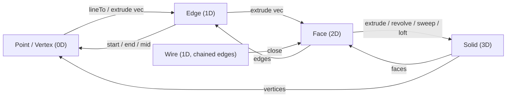
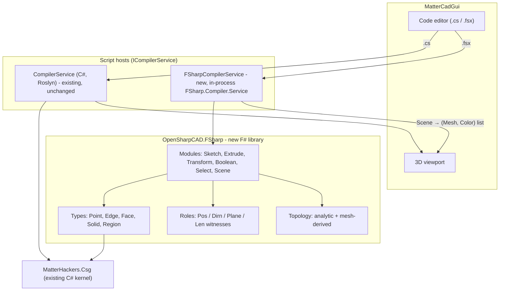

# F# CAD for OpenSharpCAD: Design Document

> Status: **Draft / proposal**. Branch: `f#`. Nothing here is implemented yet.
> Code blocks show the planned API, not working code.

---

## 1. Why F#

OpenSharpCAD scripts today are C# statements. They are compiled by
[CompilerService.cs](../OpenSharpCAD/CompilerService/CompilerService.cs) into a `Build()` method, and
geometry is drawn through side effects (`Draw(...)`). That works, but CAD is mostly
*value → value* transformation, which suits a functional-first language:

| CAD need | F# feature |
|---|---|
| A part is a function of its parameters | Pure functions, currying, partial application |
| Build geometry step by step | Pipelines `\|>` and composition `>>` |
| An "open line" should never be extruded into a solid | Discriminated unions, so invalid geometry can't be built |
| Patterns and arrays | `List.map`, `List.fold`, sequence expressions |
| Sketch DSLs | Computation expressions (`sketch { ... }`) |
| Reproducible, cacheable models | Immutability + structural equality, so meshes can be memoized |
| Uses the existing CSG kernel | Runs on .NET and calls `MatterHackers.Csg` directly |

## 2. Goals and non-goals

### Goals
1. **Interchangeable inputs.** Any function that needs a point, direction, plane
   or path accepts raw coordinates **or** a primitive taken from other geometry
   (a vertex of a box, an edge of an extrusion, a face of a box).
2. **Moving up and down in dimension.** `Point → Edge → Face → Solid` by extrusion/sweep,
   and `Solid → Faces → Edges → Vertices` by topology queries. Every level can feed every other level.
3. **Pipe-first API.** The data argument always comes last, so everything chains with `|>`.
4. **Pure by default.** A script evaluates to a `Scene` value; no hidden global state.
5. **Reuse the kernel.** F# sits as a thin functional layer over the existing C# CSG library.
6. **Industry-standard vocabulary.** Topology names follow STEP / OpenCascade
   (`Vertex`, `Edge`, `Wire`, `Face`, `Shell`, `Solid`). Operation names follow
   mainstream CAD and OpenSCAD (`extrude`, `revolve`, `sweep`, `loft`, `boss`, `pocket`,
   `translate`, `union`, `difference`, `intersection`, `linearPattern`, `circularPattern`).

### Conventions
- **Lengths are plain `float` in millimetres.** No units of measure.
- **Angles are plain `float` in degrees.** Converted to radians inside the library
  (the C# `Rotate` takes radians; the F# API hides that).
- `int` is accepted wherever a length is expected, so `box (60, 40, 10)` works without `.0`.

### Non-goals
- A B-rep kernel (OCCT-style exact topology, fillets on arbitrary edges).
- A constraint solver for sketches.
- **Any change to the C# scripting API.** Roles, topology and the dimension ladder are F#-only.
  C# scripts keep working as they do today.

---

## 3. Core idea: the dimension ladder



Every arrow is an ordinary function. Because results going *down* the ladder
(`box.Faces.Top`, `face.Edges`, `edge.Mid`) have the **same types** as primitives
you build by hand, they can be used anywhere a hand-made one can.

```fsharp
// Point ⇒ Edge ⇒ Face ⇒ Solid, one pipeline
point (0, 0, 0)
|> lineTo (40, 0, 0)          // Point → Edge
|> extrude (Z 20)             // Edge  → Face (vertical wall)
|> thicken 3                  // Face  → Solid
|> show
```

```fsharp
// box faces → extrude
let c = cube 20

c.Faces.Top
|> extrude 10                 // Face → Solid, along the face normal (+Z)
|> union c
|> show
```

---

## 4. Type model

All types are immutable F# records/unions with structural equality. Lengths are mm, angles are degrees.

```fsharp
type Point = { X: float; Y: float; Z: float }
type Vec   = { DX: float; DY: float; DZ: float }
type Dir   = private { U: Vec }                                   // unit vector, normalized on construction
type Frame = { Origin: Point; XAxis: Dir; YAxis: Dir; Normal: Dir } // local coordinate system / plane

type Curve =
    | Segment of start: Point * finish: Point
    | Arc     of center: Point * start: Point * sweepDeg: float * axis: Dir
    | Bezier  of control: Point list

type Wire   = private { Curves: Curve list }                      // connected chain, open or closed
type Region = private { Frame: Frame; Outer: Wire; Holes: Wire list } // planar, ALWAYS closed

/// Where a topology element came from (lets Face know its parent Solid).
type Origin = { Owner: SolidId; Tag: string }                     // e.g. Tag = "Top", "Lateral[3]", "EndCap"

type Vertex = { At: Point;      From: Origin option }
type Edge   = { Curve: Curve;   From: Origin option }
type Face   = { Region: Region; From: Origin option }
type Shell  = { Faces: Face list }                                // open sheet of faces

type Solid  = private {
    Id:   SolidId
    Csg:  Lazy<CsgObject>          // existing C# kernel object
    Topo: Lazy<Topology> }         // vertices / edges / faces, computed on demand
and Topology = { Vertices: Vertex list; Edges: Edge list; Faces: Face list }
```

**Rules enforced by the types**

- `Region` can only be built by `Wire.close`, `rectangle`, `circle`, etc. So a `Face` is
  closed **by construction**. The current runtime check (`ValidateClosed("extrude")`)
  becomes a compile error for most mistakes.
- `Dir` can't be zero-length.

### Refined solids keep their named topology

Primitive constructors return refined types that still behave as a `Solid`
(they implement `ISolid`, and every API function takes `#ISolid`):

```fsharp
type BoxFaces = { Top: Face; Bottom: Face; Left: Face; Right: Face; Front: Face; Back: Face }
                member All : Face list

type Box      = { Solid: Solid; Size: Vec; Faces: BoxFaces; Vertices: Vertex list; Edges: Edge list }
type CylinderFaces = { Top: Face; Bottom: Face; Lateral: Face }
type Cylinder = { Solid: Solid; Radius: float; Height: float; Faces: CylinderFaces; Axis: Edge }
type Extrusion = { Solid: Solid; StartCap: Face; EndCap: Face; Lateral: Face list }  // Lateral[i] comes from profile edge i
```

`box (x, y, z)` and `cube size` both return a `Box`. This builds on what the C# `Box`
already exposes (`Corners`, `BoundingEdges`, `Points`, `Lines`).

---

## 5. Interchangeable inputs: the "role" system

A parameter asks for a **role**, not a concrete type. Anything that has a sensible
reading in that role is accepted, **implicitly**.

| Role | Accepted inputs | How it is read |
|---|---|---|
| **Length** | `int`, `float` | mm |
| | `Edge` | its length |
| **Position** | `(x,y)`, `(x,y,z)`, `Point`, `Vertex`, `Vector3`, C# `Point` | the point itself |
| | `Edge` | midpoint |
| | `Face` | centroid |
| | `#ISolid` | bounding-box center |
| **Direction** | `Vec`, `Dir`, `X/Y/Z n`, `(dx,dy,dz)` | the vector |
| | `Edge` | start → end (also gives a **length**) |
| | `Face` | outward normal |
| **Plane / Frame** | `Frame`, `XY`/`YZ`/`XZ` | as is |
| | `Face` | the face's plane, origin at its centroid |
| **Path** | `Edge`, `Wire`, list of positions | the curve |
| **Profile** | `Face`, `Region`, closed `Wire` | the region |

The implicit readings are the default. `Face.centroid`, `Edge.mid` and `Solid.center`
are there for readability, but nothing requires them.

**How it works.** Core functions are *non-inline* and take the canonical type
(`Point`, `Dir`, `Frame`, ...). Thin `inline` wrappers use SRTP "witness" overloads
(`Pos.Of`, `Dirn.Of`, `Plane.Of`, `Len.Of`) to convert the argument first. Our own types
just implement small interfaces (`IHasPosition`, `IHasDirection`, `IHasFrame`), and
the witnesses add tuples, numbers and the C# kernel types (`Vector3`, `Point`, `Line`).

```fsharp
// all four produce the same edge
lineTo (40, 0, 0)        (point (0, 0, 0))
lineTo (point (40, 0, 0)) origin
lineTo c.Vertices[1]     c.Vertices[0]          // vertices from a box
lineTo c.Faces.Right     c.Faces.Left           // face centroids
```

> [!NOTE]
> Optional sugar: `-->` as an operator for `lineTo`: `point (0,0,0) --> (40,0,0)`.

---

## 6. Overloaded operations by dimension

Some verbs mean different things at each level. They are written as SRTP
member-constrained functions, so one name works across the ladder:

| Function | Input → Output | Meaning |
|---|---|---|
| `extrude d` | `Point → Edge` | sweep a point along a direction |
| | `Edge → Face` | ruled planar quad |
| | `Wire → Shell` | open sheet (use `thicken` to get a solid) |
| | `Face → Extrusion` | prism along the face normal (or along `d` if it's a direction) |
| `revolve axis angle` | `Edge → Shell`, `Face → Solid` | lathe |
| `sweep path` | `Face → Solid` | profile follows an `Edge` / `Wire` |
| `loft` | `Face list → Solid` | skin between profiles |
| `thicken t` | `Face / Shell → Solid` | offset both sides |

The **distance argument** of `extrude` is itself a role:

```fsharp
face |> extrude 10                 // along the face normal, 10 mm
face |> extrude (Z 10)             // along an explicit vector
face |> extrude someEdge           // direction AND length taken from an edge
face |> extrudeUpTo otherFace      // "up to surface": the plane of another face
face |> extrudeUpTo (0, 0, 50)     // "up to vertex": the parallel plane through a point
```

### Feature operations use provenance

A `Face` remembers its owner solid, so feature-style operations don't need the
parent passed in again:

```fsharp
let b = box (60, 40, 10)

b.Faces.Top |> boss   15           // = b ∪ extrude 15 top
b.Faces.Top |> pocket  4           // = b − extrude inward 4
```

---

## 7. Selectors (queries over topology)

Selectors are plain functions over lists, so they compose with `List.*`:

```fsharp
let faces    (s: #ISolid) : Face list
let edges    (s: #ISolid) : Edge list
let vertices (s: #ISolid) : Vertex list

module Face =
    val facing     : direction -> Face list -> Face list    // normal within tolerance
    val largest    : Face list -> Face
    val nearest    : position  -> Face list -> Face
    val edges      : Face -> Edge list
    val normal     : Face -> Dir

module Edge =
    val parallelTo : direction -> Edge list -> Edge list
    val onFace     : Face -> Edge list -> Edge list
    val longest    : Edge list -> Edge
```

Example: holes at the four top corners of a plate.

```fsharp
let plate = box (80, 50, 6)

plate.Vertices
|> List.filter (Vertex.onFace plate.Faces.Top)
|> List.map    (fun v -> cylinder 2.5 20 |> moveTo (v |> inset 6))
|> List.fold   difference plate
|> show
```

---

## 8. Transforms, booleans, patterns

Same rule everywhere: **data last**, roles for parameters.

```fsharp
translate : direction -> #ISolid -> Solid            // Vec, Edge, (x,y,z)...
moveTo    : position  -> #ISolid -> Solid            // put local origin at a position
rotate    : axis -> angleDeg -> #ISolid -> Solid     // axis: Edge, Dir, X/Y/Z
mirror    : plane -> #ISolid -> Solid                // plane: Face, Frame
scale     : float -> #ISolid -> Solid
placeOn   : Face -> #ISolid -> Solid                 // align local XY frame to a face

union / difference / intersection : #ISolid -> #ISolid -> Solid
(+) (-) (*)                                          // same operators as the C# API

linearPattern   : count:int -> step:direction -> #ISolid -> Solid list
circularPattern : count:int -> axis -> #ISolid -> Solid list
pathPattern     : path -> count:int -> #ISolid -> Solid list   // distribute along an Edge/Wire
```

```fsharp
// 6 spokes around a hub, each spoke placed on the hub's lateral face
let hub = cylinder 10 8

box (30, 4, 4)
|> placeOn hub.Faces.Lateral
|> circularPattern 6 hub.Axis
|> List.fold union hub.Solid
```

---

## 9. Sketching

A `sketch` computation expression builds a `Wire` and returns a closed `Region`
when it ends with `close`:

```fsharp
let profile =
    sketch XY {
        moveTo (0, 0)
        lineTo (30, 0)
        arcTo  (30, 20) 10
        lineTo (0, 20)
        close                       // result type: Face (closed by construction)
    }

profile |> extrude 5
```

Sketches can sit **on a face from another solid**: `sketch b.Faces.Front { ... }`
uses that face's frame as its local XY.

---

## 10. Scripts and scene output

An F# script **evaluates to a value** instead of calling `Draw` for side effects:

```fsharp
// bracket.fsx
let bracket w h t =
    let basePlate = box (w, 30, t)
    basePlate.Faces.Back
    |> boss h
    |> fun s -> faces s |> Face.facing (Y -1) |> Face.largest
    |> pocket 2

scene [
    bracket 40 25 4                 |> color Steel
    point (0, 0, 0) --> (60, 0, 0)  |> color Red     // edges/points are drawn as wires
]
```

`show x` stays available as a convenience that adds `x` to an implicit scene,
for people coming from the C# scripts.

---

## 11. Architecture



| Component | Change |
|---|---|
| `OpenSharpCAD.FSharp` (new `.fsproj`) | The F# API. Consumed by `.fsx` scripts and compiled F# projects only. |
| `FSharpCompilerService` (new) | Hosts `.fsx` **in-process** with FSharp.Compiler.Service (`FsiEvaluationSession`), references the library, evaluates to a `Scene`, converts to `(Mesh, Color)` the same way `Draw` does today. One session is kept warm so only the first compile pays the startup cost. |
| `ICompilerService` | Pick the host by file extension. Diagnostics need a language-neutral type (today it's Roslyn `Diagnostic`). |
| C# script API | **No change.** |
| `AutoDocumentationService` | Later: also generate the F# API reference. |
| Editor completion | Later: F# completion through the same FCS instance (`GetDeclarationListInfo`). |

---

## 12. Topology: the hard part

`MatterHackers.Csg` is a **CSG tree**, not a boundary representation. Faces and edges
don't exist as first-class things, so topology is produced at three levels:

| Level | Source | Accuracy | Phase |
|---|---|---|---|
| **Analytic** | Primitives (`box`, `cylinder`, `extrude`, `revolve`) know their own faces/edges/vertices | exact, named (`Top`, `Lateral[2]`) | 2 |
| **Propagated** | Transforms (`translate`, `rotate`, `mirror`, `scale`) apply their matrix to the analytic topology | exact | 2 |
| **Mesh-derived** | After booleans: mesh the result, group coplanar triangles into planar `Face`s, extract boundary loops as `Edge`s | approximate (curved faces come out faceted), unnamed | 4 |

> [!WARNING]
> Names don't survive booleans ("topological naming problem"). After `difference`, `b.Faces.Top`
> still points at the **original** top face, not at whatever is left of it. Selectors
> (`Face.facing`, `Face.nearest`) work on the new solid and are the recommended way
> to grab faces after booleans.

---

## 13. Errors

- **Compile time** (preferred): open profiles and wrong dimension
  (`extrude` on a `Solid`) are type errors.
- **Run time**: degenerate input (zero-length edge, zero-area face, a selector that
  matches nothing) raises `CadError` with the script line number, same as the
  existing `LastErrorLine` handling.
- `try*` variants (`tryExtrude`, `Face.tryLargest`) return `Result<_, CadError>`
  for code that wants to handle failures itself.

---

## 14. Performance

- Solids are immutable, so `Solid → Mesh` conversion is **memoized** by structural
  hash. Editing one parameter only re-meshes the subtrees that changed.
- `Csg` and `Topo` are `Lazy`. A script that never queries faces never computes them.
- Mesh-derived topology (phase 4) is the expensive path. It runs only when a
  selector is applied to a boolean result.
- FSharp.Compiler.Service adds about 30–40 MB to the app and a slow first compile.
  A warm FSI session started in the background at app launch hides most of that.

---

## 15. Testing

- **xUnit** for the API surface, next to [CSharpCad.UnitTests](../CSharpCad.UnitTests).
- **FsCheck property tests**, which pure functions make easy:
  - `volume (extrude h f) ≈ area f * h`
  - `translate v >> translate (-v) = id` (by bounding box)
  - `faces (box (a, b, c)) |> length = 6`, and each normal is opposite exactly one other
  - `extrude d (lineTo b a) |> area = |b−a| * |d|`
  - every role reading gives the same result: `lineTo (40,0,0)` = `lineTo (point (40,0,0))` = `lineTo vertex`
- **Golden scripts**: a set of `.fsx` examples whose mesh bounding boxes and triangle
  counts are snapshotted.

---

## 16. Phased plan

| Phase | Deliverable |
|---|---|
| **0** | This document (current step) |
| **1** | `OpenSharpCAD.FSharp` library: types, role witnesses, primitives, transforms, booleans, `Scene → Mesh`. Tested from xUnit. |
| **2** | Analytic + propagated topology, `extrude`/`revolve`/`sweep`/`loft` across dimensions, `boss`/`pocket`, selectors. |
| **3** | `.fsx` scripting in MatterCadGui through in-process `FSharpCompilerService`, language-neutral diagnostics, example scripts. |
| **4** | Mesh-derived topology after booleans, `sketch` CE on any face, F# editor completion, F# API docs. |

---

## 17. Decisions

| # | Question | Decision |
|---|---|---|
| 1 | Script host | Embed **FSharp.Compiler.Service** in-process (size and first-compile cost accepted). |
| 2 | Units | **No units of measure.** Lengths are plain `float` mm, angles are degrees. |
| 3 | Naming | **Industry standard**: `point`, `Vertex`/`Edge`/`Wire`/`Face`/`Shell`/`Solid`, `box`/`cube`, `.Faces`, `boss`/`pocket`, `translate`, `union`/`difference`/`intersection`, `linearPattern`/`circularPattern`. |
| 4 | Implicit readings | **Implicit.** A `Face` used as a position means its centroid, an `Edge` means its midpoint, and so on (see §5). |
| 5 | Interop | **F#-only.** The C# script API is not changed. |
